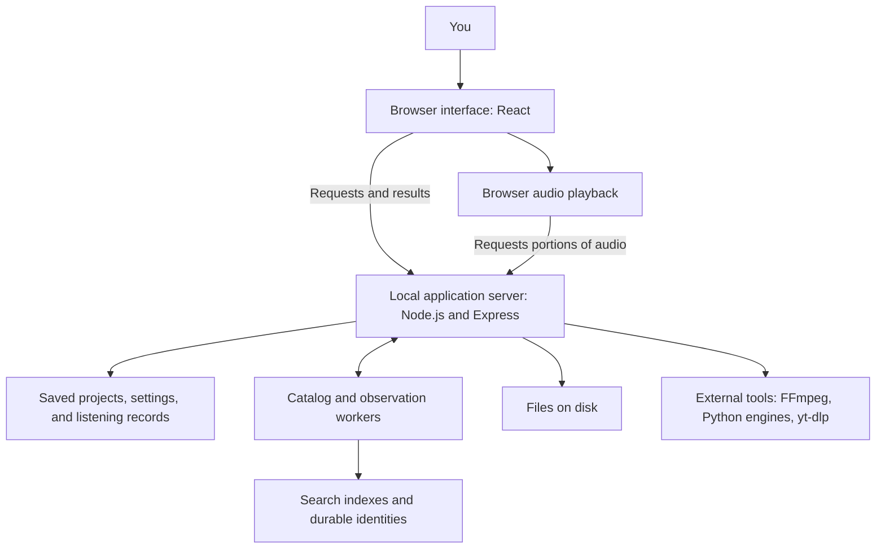

# How SwissMouse works

A guide for the project owner, users who want to understand the application, and developers working on it.

**Status: Alpha 5 has launched; Alpha 6 is in development.** This guide was checked against the source on October 28, 2026. Package metadata still says `0.1.0-alpha.5`. The [Alpha 6 scope](docs/ALPHA6.md) records the four release goals.

Throughout this document:

- **Today** describes the existing implementation.
- **Alpha 6 goal** describes the agreed release direction.
- **Proposed design** explains how that direction should work. It still needs implementation and, where noted, a design decision.
- **Later** describes the broader vision beyond the current release goals.

The largest change is ownership: SwissMouse provides common services, while an independently installed Audiobook module provides audiobook-specific tools. The [Batch 11 implementation checkpoint](docs/BATCH11-SEPARATE-APPLICATION.md) describes the new separate Core/full-module candidates, protocol 2 and their validation. The normal development command still opens the legacy combined application while delivery checks finish. The repository targets are `Bageena/SwissMouse` for Core and the existing `Bageena/SwissMouse-Audiobook-Workbench` for Audiobooks.

## Contents

1. [The overall picture](#1-the-overall-picture)
2. [What runs when you open SwissMouse](#2-what-runs-when-you-open-swissmouse)
3. [Resources, files, and saved work](#3-resources-files-and-saved-work)
4. [How the existing features fit together](#4-how-the-existing-features-fit-together)
5. [Workflows and background work](#5-workflows-and-background-work)
6. [Workspaces, panels, and themes](#6-workspaces-panels-and-themes)
7. [Modules and the Audiobook extraction](#7-modules-and-the-audiobook-extraction)
8. [Plugins](#8-plugins)
9. [Installing, updating, and removing modules](#9-installing-updating-and-removing-modules)
10. [Dependencies and models](#10-dependencies-and-models)
11. [Preferences and Quick Settings](#11-preferences-and-quick-settings)
12. [The Notes foundation](#12-the-notes-foundation)
13. [The full File Manager and Audio Player](#13-the-full-file-manager-and-audio-player)
14. [Safety, privacy, and recovery](#14-safety-privacy-and-recovery)
15. [A map of the source code](#15-a-map-of-the-source-code)
16. [Decisions still to make](#16-decisions-still-to-make)

## 1. The overall picture

SwissMouse is becoming a desktop for working with media, information, and tools. Its shared foundation should let those tools work with the same files and information without creating separate copies or conflicting settings.

Today, the application is still largely organized around audiobooks. It already has reusable pieces: a catalog, stable resource identities, file operations, playback, panels, themes, and tool installation. Several of those pieces still contain audiobook assumptions. Alpha 6 will turn more of that foundation into independent core services.

| Term | Meaning in SwissMouse | Example |
| --- | --- | --- |
| Core / host | The common application that provides services to installed tools. | Navigation, resource lookup, Preferences, dependency management. |
| Module | A substantial area of work with its own screens and behavior. | The Audiobook module. |
| Plugin | An optional capability that extends the core or a module. | A future metadata provider or transcription integration. |
| Workflow | An ordered process for completing a task. | Prepare audio, review chapters, edit metadata, convert, check output. |
| Workspace | An arrangement of tools and panels for a task. | The chapter review screen. |
| Resource | Something the application identifies and can refer to reliably. | A work, recording, or file. |
| Dependency | Software another feature needs in order to run. | FFmpeg for audio conversion. |
| Model | Downloaded data used by an AI engine. | Speech-recognition model weights. |
| API / contract | An agreed way for two parts of the app to communicate. | Asking the catalog for a page of matching resources. |

Modules and plugins will use contracts to request shared services. Those contracts define what requests mean, what information comes back, and which versions can work together.

## 2. What runs when you open SwissMouse

**Today:** SwissMouse is a local web application. A browser displays the interface, while a program running on your computer does the filesystem and processing work.

The **frontend** is the part you see: buttons, forms, lists, and panels. It uses React, which builds the screen from reusable components. The **backend** is the local server. It checks requests, reads and writes saved state, accesses files, and launches processing tools. A button generally asks the backend to perform an operation rather than modifying a file itself.

On Windows, `Start Audiobook Workbench.bat`:

1. Selects its own folder as the application root, so launching from a shortcut does not change where data is found.
2. Checks for Node.js, the program that runs the backend, and npm, which installs its JavaScript packages.
3. Installs the locked application packages when `node_modules` is absent. A source checkout can also build the application if the compiled server is missing.
4. Starts the compiled server, which loads saved state, checks available tools, starts reconciliation and recovery work, and opens the browser when requested by the launcher.

During development, Vite serves the frontend and updates it as source files change. A release serves the compiled files from `dist/`. These are two ways to run the same application, not two different product architectures.

The catalog runs database work in a **worker**, a separate execution thread, so searches and indexing do not have to run directly inside a playback request. Media tools run as separate programs. This helps responsiveness, but does not mean every operation is nonblocking or that all jobs can run simultaneously.

**Network boundary:** the current server listens on all network interfaces (`0.0.0.0`, normally port 3000), even though the launcher opens a local address. Reachability depends on the computer's firewall and network. Its APIs include local administrative file operations and are not the future authenticated SwissMouse Server publication service. The application should be treated as a trusted local administration tool.

## 3. Resources, files, and saved work

**Design direction:** the future core will combine registered resource types, typed metadata, relationships, taxonomies, shared views, and autocomplete. A managed-information browser will support shelves/covers/lists independently of the physical File Browser, and a later desktop will launch modules/tools. See [shared resource core direction](docs/SHARED-RESOURCE-CORE.md) for scope, deferred additional-type testing, and performance requirements. These generalized contracts are not yet the current audiobook-backed catalog implementation.

### One thing can have several related identities

Consider a novel recorded by two different narrators and stored as several audio files:

- The **work** identifies the underlying book.
- Each **recording** identifies a particular audio version.
- Each **file** identifies a physical media item.
- A **processing project** records the work being done: chosen source files, their order, metadata, chapters, transcription, and outputs.

These are related, but they are not interchangeable. A note at 12 minutes into one recording may not match 12 minutes into another.

**Today:** the resource contracts distinguish works, recordings, and files. The catalog projects existing audiobook projects into those shared resource types. It is a foundation for other modules; it is not yet a complete general-purpose store for every future resource kind.

A stable ID is an internal identity that survives supported renaming, moving, and relinking. A title is a label; a path tells the app where a file currently lives. Neither should become the identity used by every other part of the app. Arbitrary changes made outside SwissMouse may still require reconciliation or an explicit relink.

### The catalog is the searchable view

The catalog is like a searchable index over saved information. Library views ask it for a bounded page of results instead of loading every project and transcript into the browser. Detailed project data is loaded when needed.

The application separates **durable information**, which must be preserved, from **rebuildable indexes**, which can be reconstructed from durable records and observed files. Both use SQLite, a database stored in local files rather than a separately installed database server.

| Location under the application root | What it holds | Treat as |
| --- | --- | --- |
| `jobs.json.sqlite` | Saved projects, metadata, chapter work, processing state, and other project records. | Essential user data. |
| `jobs.json.assets/` | Large saved payloads referenced by projects, such as transcripts and cover data. | Essential user data. |
| `catalog.sqlite.user.sqlite` | Durable identity aliases and collection membership. | Essential user data. |
| `listening/` | Listening positions and related records for the current local profile. | Essential user data. |
| `config.json`, `ui-preferences.json` | Application configuration and shared appearance selection. | User configuration. |
| Browser storage | Layouts, view state, and some interface preferences. | Separate from the application-folder backup. |
| `catalog.sqlite`, `directories.sqlite` | Search projections and observed directory information. | Rebuildable indexes; temporary selections may be lost on rebuild. |
| `runtime/`, `models/` | App-managed programs, packages, and downloaded model data. | Installed dependencies, not project records. |
| Media folders | Original recordings, associated files, and exported output. | User content, possibly outside the application folder. |

The old `jobs.json` can remain as migration input or a backup. After migration, new project edits are saved in SQLite; copying only the old JSON will miss those edits.

**Backup rule:** stop SwissMouse, preserve all durable stores and assets together, and include externally referenced media separately. Copying the whole application folder is a useful starting point, but it does not include media elsewhere or browser-local layouts. See [installation and recovery](docs/ALPHA5-INSTALL-AND-RECOVERY.md) for the existing release's procedure and limits.

### Looking at a file is different from adding it to a project

The file browser observes what is on disk. A selection identifies what a command will act on. A project's file list identifies which files belong to that project and in what processing order.

Those three things stay separate. Browsing a directory does not attach all its audio to the current book. Removing a file from Processing Order does not delete it from disk. Physical moves and deletions go through their own reviewed operations.

## 4. How the existing features fit together

**Today:** the principal features form an audiobook preparation and organization system.

| Feature | What it does and how it connects |
| --- | --- |
| Inbox and Library | Discover and organize books using the shared catalog. A local import can reference existing files without copying them. Explicit organization and transfer actions handle physical moves. |
| Book Files | Reviews source files, project membership, order, groups, and metadata before processing. Reuses the file browser, metadata editor, and transfer services. |
| File browser | Browses directories, previews supported audio, and offers supported file commands. Mutation checks currently depend on project ownership and source boundaries. |
| Transcription | Runs a local speech engine and model, retaining text and timing information for chapter detection and review. |
| Chapter detection and review | Finds candidate boundaries from speech or existing structure, then lets the user review titles and times. Existing chapters, imported chapter files, or file groups can avoid transcription. |
| Metadata and covers | Maintains editable book information and artwork. Explicit save/write/export operations determine when changes reach sidecars or media tags. |
| Conversion / export | Creates the selected audio output with reviewed metadata and chapters. Compatible audio can sometimes be copied without re-encoding; other choices require conversion. |
| Final Check | Checks finished output and records results associated with the current files and metadata. Changes can make an earlier check stale. |
| Shared player | Streams audio, handles an ordered multipart timeline, and saves listening position separately from the media files. |
| System setup and tools | Discovers dependencies and installs, repairs, or removes supported app-managed components. Models have separate management. |

Metadata in SwissMouse is not automatically the same as metadata embedded in an audio file. Saved project edits, an `exmetadata.json` sidecar, optional Audiobookshelf-compatible `metadata.json`, and embedded media tags are different representations. Writing to media requires an explicit supported operation. Personal ratings and listening positions remain separate from exported book metadata.

The shared player uses browser streaming rather than decoding an entire multi-hour book into memory. It prefers a current finalized output when available, otherwise the project's associated source files. Chapter-editor previews coordinate with the shared player to avoid competing playback. Resume information follows a verified recording timeline; matching titles or equal durations alone are not proof that two recordings share a timeline.

## 5. Workflows and background work

### The current audiobook workflow

**Today:** the five main steps are defined by the Audiobook manifest:

1. **Process audio:** prepare the source, generate analysis where needed, and find or extract chapters. Speech-based detection adds transcription; existing file/chapter structure offers other paths.
2. **Review chapters:** inspect names and boundaries, listen, edit, and save.
3. **Review Metadata:** verify the final book information.
4. **Convert:** create the selected output.
5. **Final check:** inspect the finished result before final organization and cleanup actions.

A workflow is more than a row of navigation buttons. It also needs rules about required inputs, saved results, and what becomes outdated after a change.

For example, changing the chapter detector can reuse a suitable saved transcript. Rerunning transcription can make derived chapters stale. Changing reviewed metadata can require a new export and Final Check. A theme change should not require retranscribing a book.

The code tracks these dependencies and caches expensive results using source and settings fingerprints: compact identifiers describing the inputs used. Failed reruns can retain previous successful output for recovery; a retained result is not automatically current. Experimental Improved Chapter Detection remains opt-in, and its additional suggestions require review and acceptance before normal saving.

**Current limit:** workflow navigation and processing state are specialized for audiobooks. There is no general user-built workflow editor or shared dispatcher for arbitrary module actions yet.

### How workflows should expand

**Proposed design:** a module should describe its steps and contribute the operations they invoke. SwissMouse should provide common progress, cancellation, dependency checks, and job coordination.

Each operation should describe:

- Its inputs and output, using resource IDs where appropriate.
- The tools and permissions it requires.
- Whether it reads data, writes data, or launches another program.
- Its progress and completion state, and when cancellation is safe.
- Which previous results it can reuse and which downstream results become stale.
- What happens on failure or retry, especially after a partial write.

A **job** is one execution of an operation. Job progress belongs to the execution service rather than the visible panel, so closing a panel does not need to terminate the work. Retrying a move must check what already completed rather than copy or delete files a second time blindly.

A later workflow editor could connect these described operations. It should use validated operation IDs and inputs, not treat a saved workspace as executable JavaScript or shell commands. A general workflow editor is not one of the four Alpha 6 commitments.

## 6. Workspaces, panels, and themes

**Today:** SwissMouse uses common panel and container components to arrange tools. A panel definition describes a reusable tool surface; an instance is one placement of it. Parent and Child roles constrain docking. Grid/canvas placement, size, and layout state are presentation concerns, separate from the project being edited.

For example, moving the metadata panel changes where the editor appears. It should not create a second metadata record. A saved panel name is also different from the stable ID used to restore that panel later.

The adaptive workspace preserves preferred arrangements and resolves them for available space. Existing nesting, docking, and persistence have specific constraints; the UI is not an arbitrary unlimited tree of panels. See the [panel catalog](docs/PANELS.md) and [container guide](docs/CONTAINER-SYSTEM.md).

Themes change appearance. Built-in themes can use the app's full visual design; local custom themes use approved colors and visual tokens, which are named style values. Custom theme files do not currently add code, change processing behavior, or install modules.

**Proposed design:** installed modules should contribute panels through the same catalog. If a saved layout references an unavailable module, preserve its configuration and show a recoverable placeholder. Reinstalling the module should be able to restore the tool without reconstructing the user's layout or duplicating its data. Portable workspace import/export remains separate work.

## 7. Modules and the Audiobook extraction

### What exists today

The [Batch 1 module proof](docs/BATCH1-MODULE-PROOF.md) now supplies a separate prebuilt read-only Audiobook panel/backend operation, a minimal host-provided SDK, and Preferences → Modules installation using a locally provisioned trust catalog. It shares the host React/UI and loads its own CSS/icon. The built-in Audiobook application below remains connected while extraction proceeds; Core-only independence is still outstanding.

[Batch 2](docs/BATCH2-CHECKPOINT.md) gives the Audiobook client its own workspace coordinator and view. App keeps appearance, Preferences, logs, and common service access. Audiobooks owns editing/navigation state and its HTTP calls; its panel and workflow descriptions register during activation. The existing screens still use a temporary built-in adapter while backend and public-package extraction continue.

[Batch 3](docs/BATCH3-BACKEND-COMMANDS.md) moves project, metadata and chapter commands into the Audiobook package. The server supplies the existing database, catalog, sidecar writer and busy checks; a small route adapter preserves the URLs used by the app. These commands do not create another database or change saved record formats.

[Batch 4](docs/BATCH4-FILE-COORDINATION.md) gives that package ownership of selecting and ordering source audio, importing it, discovering books and coordinating Library transfers and interrupted-transfer recovery. The server still provides the existing verified file engines and request guards. Import/discovery/transfer activity shares one set of busy flags and locks, so the old and extracted routes cannot accidentally start conflicting work.

[Batch 5](docs/BATCH5-PROCESSING.md) moves the processing coordinator into the package: preparing audio, choosing and running transcription, making chapter markers from speech or files, and rerunning individual stages. Its progress and cancellation state is shared with the existing busy checks. It reuses the same source/preparation/transcription keys, so extraction alone does not require another transcription. Existing audio, acoustic-analysis and transcription engines are supplied by the server.

[Batch 6](docs/BATCH6-COMPLETION.md) moves export, embedded metadata writing, Final Check, finishing, storage cleanup and interrupted-archive recovery into package services. The host connects them to the existing verified transfer/archive, encoding, playback-provenance and audio-check engines. Progress and busy checks share the same state. Existing overwrite confirmations, destination previews and source-protection rules remain. A small HTTP adapter also preserves CSV download headers.

[Batch 7](docs/BATCH7-SHARED-CONTRACTS.md) is a design review for the next shared foundation. Its [proposed contracts](docs/SHARED-RESOURCE-CONTRACTS.md) separate resources, typed fields, relationships, taxonomy, actual recent choices and browser presentation, with durable ownership and migration/performance gates. This proposal is not an implemented taxonomy database or new installed SDK; the proposed next code slice is registration and an audiobook read adapter.

[Batch 8](docs/BATCH8-REGISTRY-READ-BRIDGE.md) implements that first code slice following approval: a data-only declaration registry and Audiobook read adapter, with an opt-in preview using existing catalog IDs and queries. It validates definitions and shows inert read-only fallbacks for inactive owners. It does not yet store new taxonomy/selection history, execute the proposed generic query system, or change the installed SDK. Durable generic publications come next.

[Batch 9](docs/BATCH9-DURABLE-FOUNDATIONS.md) now adds an opt-in way for Core to remember an item's basic description, fields and connections. A persistent delivery queue and checked receipts let interrupted work resume safely, and a generic index can rebuild from those remembered descriptions without audiobook interpretation code. Enabling this changes the authoritative user database, so read the [migration and recovery review](docs/INFORMATION-DURABILITY-MIGRATION.md) first. It has only been enabled in disposable test installations. Full application independence, taxonomy terms and shared autocomplete/history remain later work.

[Batch 10](docs/BATCH10-DIRECTORY-AND-PICKER.md) now provides an opt-in shared suggestion directory and a Series Name picker pilot. It searches indexed values beyond the old first-100 list. “Recent” means explicitly selected and successfully saved; “related” means observed with matching saved context, currently author names. Those are stored separately. The internal term foundation preserves term IDs through rename/retirement, but there is no general taxonomy-management screen or legacy genre conversion. Its new authoritative storage needs the documented schema-2 migration; it has not been enabled for the maintainer's library. See the [measured picker-engine limits](docs/BATCH10-PERFORMANCE.md).

The built-in module registry checks stable IDs, contract versions, and workspace ownership. The Audiobook manifest lists its screens and resource types. This is a real starting boundary, but the screen components are still imported directly into the application build.

The main React application delegates audiobook client coordination to its module entry. `server.ts` composes the extracted backend services but still contains configuration, browse/projection and other legacy API logic; some supplied engines and shared services also retain audiobook assumptions. Moving only `src/modules/audiobooks/` into another repository would leave dependencies behind. Core-only operation and a fully independent installed module still require further work.

### The Alpha 6 goal

The Audiobook module will live in its own repository and be installable within SwissMouse. SwissMouse should start and provide its core tools when the Audiobook module is absent. Installing the module should add its capabilities to that existing application.

This is the **proposed ownership split**:

| SwissMouse core should own | Audiobook module should own |
| --- | --- |
| Application shell, navigation, common panels, themes. | Audiobook screens and workflow definitions. |
| Resource identity and common catalog/query services. | Book/recording interpretation and audiobook-specific catalog contributions. |
| General file operations and shared playback services. | Audiobook source ordering, chapter logic, and playback adapters for book timelines. |
| Preferences registration and common settings storage mechanics. | Audiobook preference definitions and processing options. |
| Dependency discovery, installation ownership, and shared job infrastructure. | Declarations of the tools each audiobook operation needs. |
| Storage/migration facilities and shared reference rules. | Audiobook project data definitions and changes to those definitions. |
| Notes foundation and shared reference access. | Optional links from chapters or recording positions into Notes. |

The common service should own the general operation; a module supplies its domain rules. For example, the core can provide verified file transfer, while the Audiobook module determines which files form a book and which sidecars belong with it.

The host/module contract needs a version so a module built for a newer interface can be rejected clearly by an older host. That contract is separate from the module's release number and from its saved-data format version. Updating code and upgrading stored data are related but different operations.

Existing projects need an explicit migration path. Their stable IDs, chapters, transcripts, listening records, and source relationships must survive extraction. The goal is for users to install the module and continue their work, rather than reimport their library to make the new architecture function.

## 8. Plugins

**Today:** there is no general third-party plugin installer or runtime loader. The catalog contract explicitly reports `runtimePlugins: false`. Current imports, engines, and providers are built-in integrations even when their behavior resembles a future plugin.

**Proposed design:** a module supplies an area of work; a plugin adds an optional capability to the host or a module. A plugin might add a metadata source, importer, transcription backend, viewer, or action. A plugin should declare what it extends rather than edit another module's source or reach into its private database tables.

A **manifest** is the extension's identification and requirements sheet. Future manifests should describe identity, version, compatible host/module versions, contributed screens/actions/preferences, dependencies, and requested access. The existing built-in manifest contains only part of that information; the downloadable format is undecided.

Settings from plugins should appear through Preferences. Long operations should use shared jobs. Resource access should use host services. A transcription plugin, for example, could receive approved audio input and return transcript words with timestamps; the Audiobook module could then use that result for chapter detection.

**Trust must be designed explicitly.** Code imported into the main server can inherit that server's access to local files and processes. A manifest that says “read only” does not itself enforce read-only behavior. A safe extension system needs an execution model and real backend access checks. Whether initial first-party modules are trusted in-process code, separate processes, or use another boundary is still open. General third-party execution needs its own isolation design.

Installing the first separate Audiobook module is an Alpha 6 goal. A public plugin store and a complete third-party plugin ecosystem are broader future work.

## 9. Installing, updating, and removing modules

**Proposed full design.** The initial locally approved, restart-based loader exists for the read-only Batch 1 proof; public distribution, dependency solving, and complete migration/update recovery remain future work. The full module lifecycle should make the following understandable to the user:

1. **Inspect:** show the publisher/source, version, compatible SwissMouse versions, contributed features, required tools, download/storage requirements, and requested access.
2. **Plan:** check compatibility and find usable dependencies. Explain conflicts and extra downloads before changing the installation.
3. **Stage:** download into a temporary location, verify the package against the chosen integrity/authenticity scheme, and reject unsafe archive paths. Hash checking detects changed bytes; it is not by itself proof of a trustworthy publisher.
4. **Prepare:** install approved missing dependencies in host-managed locations and create recovery material before any saved-data upgrade.
5. **Activate:** register the module's screens, actions, resource adapters, and Preferences after installation checks succeed. The design must specify when a restart is required.
6. **Maintain:** expose enable/disable, update, repair, and removal with clear status and diagnostic details.

An update should leave the previous installation recoverable until the replacement is validated. If it changes stored data, reverting code alone may not be enough; recovery must account for both the code version and the data version. The exact transactional update and migration mechanism still needs implementation.

Disabling a module should stop new work from starting, settle or safely cancel active jobs, and preserve its data. Uninstalling its code should retain user projects, notes, and media by default. Deleting user data is a distinct reviewed action. Shared dependencies must not be removed while another installed capability still uses them.

A separate repository is where developers maintain the module's source. Users should normally install a packaged module through SwissMouse; they should not need to clone a repository and configure a development environment. Repository name, hosting, package format, and distribution mechanism remain open decisions.

## 10. Dependencies and models

**Distribution policy:** avoid packaging third-party software unless necessary. External processing tools should remain separately acquired programs, invoked through documented command/file interfaces, rather than code merged into SwissMouse. Reuse compatible existing installations or offer explicit upstream downloads into app-managed storage. Packaging exceptions require a documented need and artifact-specific license review. SwissMouse also uses application libraries such as React and Express; some frontend library code necessarily appears in the current browser build. Those dependencies retain their own licenses and notices. “Wrapper” describes the external-tool relationship, not the whole application or a legal exemption.

### There are several kinds of dependency

**Today:** “install dependencies” can mean different things:

| Kind | Purpose | Current management |
| --- | --- | --- |
| Node.js and JavaScript packages | Run the application and its interface/server libraries. | Node/npm are required by the launcher; `package-lock.json` records the application package versions installed by npm. |
| Media programs | Inspect, convert, and download supported media. | System setup discovers FFmpeg, FFprobe, and yt-dlp or installs supported app-managed copies. |
| Python environments and packages | Run speech engines and their numerical libraries. | Compatible system environments or the private `runtime/venv` fallback. |
| Speech models | Supply the learned data used by a speech engine. | Separate downloads and model management under `models/`. |
| GPU support | Allow particular engines to use compatible hardware. | Backend-specific checks and optional libraries; SwissMouse does not install system GPU drivers. |

FFprobe reads information about media. FFmpeg performs media processing. Faster Whisper uses CTranslate2 for inference; regular Whisper uses PyTorch. Installing one backend's acceleration libraries does not prove another backend can use the GPU. Having an engine installed is also different from having its model downloaded.

### How selection and installation work today

SwissMouse normally discovers compatible tools already available through the launcher's `PATH`, the operating system's search list for programs. It falls back to its app-managed copies when needed. The chosen source, version, and path are visible in System setup and tools.

- FFmpeg and FFprobe are selected as a compatible pair.
- Each speech engine uses a complete working Python environment. Packages from unrelated Python installations are not pieced together to make an engine.
- Discovery checks availability without downloading or loading speech models. Routine status requests use cached checks.
- Explicit **Check again** refreshes discovery while idle. Selected paths stay fixed during active work.
- Installation and removal through SwissMouse target its private environment and supported app-managed tools. System-owned copies are managed outside SwissMouse.
- Optional removal explains dependent features and preserves models and project data. Models are removed separately. There is no blanket automatic rollback for every Python package change.

Feature requirements are shared between the interface and backend. This makes it possible to explain why a command is unavailable and also reject a direct API request when its requirements are missing. Different audiobook paths need different dependencies: extracting chapters from existing structure does not require a speech model.

`SWISSMOUSE_RUNTIME_MODE=managed` selects the app-managed discovery mode. Exact supported tool versions, repair behavior, and removal constraints are maintained in [REQUIREMENTS.md](REQUIREMENTS.md).

### How this should work for installed modules

**Proposed design:** modules declare capabilities and compatible versions they need; the host resolves and manages the actual programs. A module should request “audio inspection” or a particular transcription capability rather than silently install a private second copy of every tool.

The dependency manager should:

- Install what the selected feature requires, with optional engines and models clearly identified.
- Reuse a compatible existing installation and record which modules use it.
- Keep operating-system ownership separate from SwissMouse ownership.
- Explain version conflicts. Reuse compatible versions; when necessary, use deliberately isolated environments instead of replacing a version needed by another module.
- Check actual usability after installation, show progress and errors, and respect cancellation at safe points.
- Preserve provenance and required license notices for acquired tools.
- Make cleanup explicit and check remaining users of a dependency before removal.

Example: installing Notes should not require speech-model downloads. Installing Audiobooks may offer transcription support, but a user working from existing chapters should be able to see which dependencies that path actually needs. Shared dependency management means coordinated ownership; it does not require one universal Python environment for every incompatible engine.

## 11. Preferences and Quick Settings

**Today:** Preferences in the header gear menu opens an initial full Preferences page with Appearance, Files & storage, Audiobooks, and Requirements categories and section search. It reuses the existing configuration editors and embeds System setup with official dependency descriptions and license/source links. The same gear menu includes Technical Logs, Free Up Space, Quick Settings, and System Check. Project-specific processing/model controls and browser layout state remain in their existing locations. See the [Preferences guide](docs/PREFERENCES.md) for the implemented contribution interface and current limits.

**Alpha 6 goal:** **Preferences** becomes the central settings destination, opened from the top-right settings icon in the main header, including settings contributed by modules and plugins. The existing settings surface becomes a more useful **Quick Settings** interface.

**Accepted design:** shared categories with extension-owned sections. The initial trusted registration interface supports searchable section descriptions, standard fields, and specialized panels. External plugin loading, private extension storage adapters, and broader category/field types remain future work.

### Central Requirements section

Requirements is a dedicated Preferences category tracking dependencies used by SwissMouse and installed modules/plugins in one place. A shared dependency appears once and lists all of its consumers.

Show required, recommended, and optional classifications in context: a speech engine can be required for transcription without being required to open SwissMouse. Each entry should explain its purpose, affected features, installed/readiness status, compatible and installed versions, source, location, and whether SwissMouse or the operating system owns it.

Provide supported install, repair, update, and uninstall actions with progress and errors. Explain affected consumers before removal. Modify only supported app-managed copies; direct users to external management for system-owned installations. Shared dependencies, project data, and separately downloaded models need distinct removal handling.

Include upstream download/source links, license and notice information, and any applicable acceptance step before acquiring a component. Installing into the application folder does not change a dependency's license. Repackaging downloaded runtimes into a distributable SwissMouse bundle requires a separate artifact-specific review; the current release excludes those runtimes.

### Settings contributions and scope

**Proposed design:** each setting declares its owner, stable key, label, explanation, value type, default, validation rules, and scope. The host uses that description to organize and save it. A namespaced key such as `audiobooks.transcription.language` prevents two extensions from accidentally claiming the same setting. This is an illustrative key, not an existing API.

Preferences should distinguish:

- **Application defaults:** general behavior for future work.
- **Module/plugin defaults:** configuration for a capability.
- **Project overrides:** choices made explicitly for one project.
- **Local presentation state:** layout or device/browser-specific behavior.

The screen can bring these together without pretending every setting has the same scope. It should explain when a change affects only future jobs, a particular project, or requires a restart.

Quick Settings should edit the same underlying values as Preferences. Its exact controls still need selection. Processing screens can retain useful contextual controls tied to the same settings system; centralizing configuration should not force users to leave their task for every adjustment.

Existing saved choices need migration rather than silent reset. A missing module's settings should be retained for recovery/reinstallation. Secrets such as future provider API keys need protected storage and must be excluded from ordinary workspace exports; the secret-storage design is still open.

## 12. The Notes foundation

**Alpha 6 goal:** establish the core of the Notes app. No Notes storage and editor system is established by the existing module/resource contracts.

**Proposed design:** a note should be saved once, have a stable identity, and be accessible through the appropriate views. Opening the same note in a book workspace and a general Notes screen should not create two copies that later disagree.

References should link to the thing they describe. For audio, that means a recording identity and a timestamp or range. If the recording changes, the app should detect that a reference may no longer line up. Similar principles apply to an edition of a book or a particular file.

Before implementation, define the first editor/content format, save and recovery behavior, ownership, basic organization, search, and supported references. Notes-specific storage may be separate from audiobook projects while reusing the core identity and query facilities. The precise storage schema is undecided.

The larger vision includes Markdown, audio notes, sketches, sticky notes, and templates. The Alpha 6 commitment is the foundation, not every possible note type, collaboration feature, or synchronization method.

## 13. The full File Manager and Audio Player

### File Manager

**Today:** Book Files contains a substantial file browser, command handling, indexed directory access, audio previews, and supported file operations. Its mutation rules are tied to the current project and source root.

**Alpha 6 goal:** a dedicated full File Manager screen with bulk actions.

**Proposed design:** reuse the file services and command definitions, then deliberately generalize their scope beyond an audiobook project. A standalone manager needs explicit rules for selected roots, files shared by several projects, and how resource references change after a move.

Bulk actions should capture the intended selection, show the affected files and destination, check collisions and ownership, report per-item results, and preserve recovery information. A large operation must handle partial completion. Undo should only be offered where its recovery behavior is actually implemented. The exact bulk command set still needs definition.

### Audio Player

**Today:** the shared playback controller owns streaming, transitions, listening checkpoints, and preview coordination. Its manifests and listening records still contain audiobook-specific assumptions.

**Alpha 6 goal:** a dedicated full Audio Player screen with EQ presets and a basic equalizer.

**Proposed design:** the full screen and compact player control the same playback session. General playback belongs to the core; the Audiobook module supplies book-specific timelines and chapter information through an adapter. An adapter translates a module's data into the form the shared service understands.

The EQ should adjust listening output without rewriting the source media or silently affecting exported audiobooks. Design decisions include frequency bands, preset names, output headroom to avoid distortion, bypass behavior, and which preferences persist. The present streaming player does not yet implement this proposed EQ system.

## 14. Safety, privacy, and recovery

These principles connect the architecture to everyday behavior:

- **Preserve sources.** Reference import, browsing, and project membership changes have different effects from explicit file writes, transfers, and deletion.
- **Verify destructive work.** Existing transfer paths use collision checks, verified copies, saved reference updates, and recovery records. Interrupted cleanup should not silently become an instruction to delete originals at the next startup.
- **Keep identity stable.** Supported moves should update locations while preserving references. Recreating a catalog entry is not a substitute for preserving a user's project identity.
- **Separate data from caches.** Rebuilding a search index must not erase collections, notes, transcripts, or listening history.
- **Version stored formats.** A migration converts saved data from an older format. The current project database has version checks and recovery snapshots; future module and Notes stores need their own migration rules.
- **Show failure honestly.** Downloaded packages do not prove successful GPU inference; a completed export does not mean every possible playback device has been tested.

Existing logs and progress endpoints help diagnose startup, processing, tool installation, and recovery. They may contain local paths or project details, so they should be reviewed before sharing.

**Local-first does not mean never online.** Normal local media processing uses local tools, while dependency/model downloads, remote imports, and online metadata lookups use the network. Future cloud/LLM integrations should send private content only through an explicit user action.

**Later:** SwissMouse Server should serve only catalog/media deliberately published by Desktop/Admin. Mobile, authentication, collaboration, and private-note synchronization require separate access rules. They are not provided by exposing today's local admin server to the internet.

Large-library responsiveness comes from bounded queries, row windowing, background indexing, and avoiding unnecessary media probes. The 500,000-file direction is a scale target, not a promise that scanning, transcription, bulk edits, or real network storage are instantaneous. See [catalog limits and verification](docs/RESOURCE-CATALOG.md#scope-and-scale-limits).

## 15. A map of the source code

This table is for readers who want to find where a behavior lives. File locations describe the current checkout and will change during module extraction.

| Area | Useful starting points |
| --- | --- |
| Startup and build | [Windows launcher](Start%20Audiobook%20Workbench.bat), [package scripts](package.json), [release assembler](scripts/build-release.ts). |
| App composition and local APIs | [React shell](src/App.tsx), [Audiobook workspace coordinator](src/modules/audiobooks/useAudiobookWorkspace.ts), [local server](server.ts). The shell delegates audiobook client behavior; the server still contains substantial audiobook operations. |
| Modules and workflows | [Module registry](src/core/modules.ts), [Audiobook manifest](src/modules/audiobooks/manifest.ts), [built-in registration](src/modules/builtins.ts), [rerun/staleness rules](src/utils/pipelineRerun.ts). |
| Audiobook project/edit commands | [Backend entry](packages/audiobooks/src/backend.ts), [project service](packages/audiobooks/src/project-service.ts), [compatibility routes](tools/audiobook-project-routes.ts). |
| Audiobook imports, sources and transfers | [File coordinator](packages/audiobooks/src/file-backend.ts), [discovery](packages/audiobooks/src/library-discovery.ts), [transfers/recovery](packages/audiobooks/src/library-transfers.ts), [file-engine ports](packages/audiobooks/src/file-ports.ts). |
| Audiobook processing and reruns | [Processing coordinator](packages/audiobooks/src/processing-backend.ts), [speech](packages/audiobooks/src/processing-speech.ts), [detection](packages/audiobooks/src/processing-detection.ts), [engine ports](packages/audiobooks/src/processing-ports.ts). |
| Audiobook export, checks and cleanup | [Completion coordinator](packages/audiobooks/src/completion-backend.ts), [export](packages/audiobooks/src/completion-export.ts), [metadata](packages/audiobooks/src/completion-metadata.ts), [cleanup](packages/audiobooks/src/completion-cleanup.ts), [engine ports](packages/audiobooks/src/completion-ports.ts). |
| Resources and catalog | [Resource contracts](src/core/resources.ts), [catalog service](tools/catalog-service.ts), [worker](tools/catalog-worker.ts), [catalog API](tools/catalog-routes.ts). |
| Durable project data | [Project database](tools/durable-project-store.ts), [project storage helpers](tools/project-store.ts), [listening store](tools/listening-store.ts). |
| Files and transfers | [Book Files](src/components/BookFiles.tsx), [file API](tools/book-files-routes.ts), [physical operations](tools/book-file-operations.ts), [transfer service](tools/project-transfer.ts). |
| Audio and speech | [Audio engine](tools/audio-engine.ts), [transcription engine](tools/transcription-engine.ts), [chapter detection](tools/chapter-detection.ts), [Final Check](tools/final-check.ts). |
| Playback | [Shared controller](src/playback/QuickPlaybackController.ts), [book timeline adapter](tools/book-playback.ts), [playback API](tools/playback-routes.ts). |
| Dependencies | [Runtime discovery/ownership](tools/runtime-selection.ts), [feature requirements](tools/feature-dependencies.ts), [requirements planning](tools/requirements.ts), plus installation routes in `server.ts`. |
| Workspace and themes | [Workspace public API](src/workspace/index.ts), [panel catalog](src/workspace/panels.ts), [custom theme guide](CUSTOM-THEMES.md). |

The `tools/` directory contains backend implementation as well as tests; its name does not mean everything there is a downloadable external tool. Likewise, today's `job` often means the entire saved audiobook project, whereas the proposed general job service would describe an execution of an operation.

For contributors, `npm run lint` currently performs TypeScript checking, `npm run build` compiles the application and catalog worker, and the `test:*` scripts cover different feature areas. Use focused tests and relevant running-app checks. Installer checks should use disposable installations; real transcription accuracy and hardware behavior require actual models and representative audio. Reading this document or running simulated tests does not establish those results.

## 16. Decisions still to make

The four Alpha 6 goals are agreed. These implementation choices remain open:

| Area | Decision needed |
| --- | --- |
| Module delivery | Repository location, package format, trusted source verification, installation UI, and restart requirements. |
| Execution boundaries | How separate frontend/backend contributions load and which access the host can enforce. |
| Compatibility and recovery | Version policy, project migration during extraction, update rollback, and behavior when a module is missing. |
| Shared dependencies | Capability/version declarations, conflict resolution, isolated environments, and usage tracking. |
| Preferences | Contribution schema, scope/override rules, migration from existing stores, Quick Settings controls, and secrets storage. |
| Notes | Minimum editor and organization features, saved format, reference types, search, and recovery. |
| File Manager and player | Bulk command scope, standalone ownership rules, playback generalization, EQ controls and persistence. |

Detailed decisions should update this guide and the relevant subsystem document as they are implemented. Keep the [documentation index](docs/README.md), [Alpha 6 scope](docs/ALPHA6.md), and [extension contracts](docs/EXTENSION-CONTRACTS.md) aligned with the actual code.
